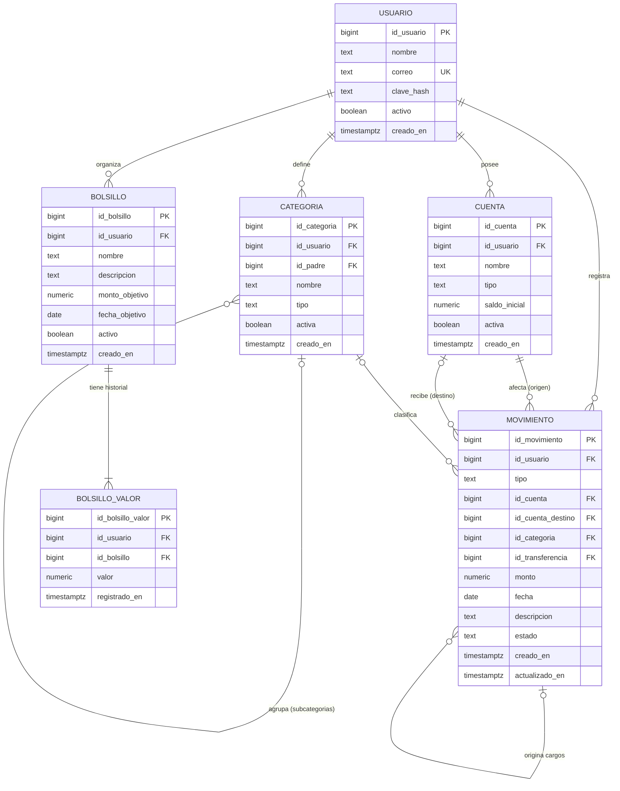

# Modelo de datos — FINANCIA+ versión 1

> Estado: **implementado** en la migración `db/migraciones/0001_esquema_inicial.sql` y
> comprobado contra la base real (las columnas y las claves foráneas de la sección 1 coinciden
> con las tablas). Si algo aquí contradice a otro documento, manda `REGLAS_NEGOCIO.md` para las
> reglas y este archivo para la estructura.

El modelo tiene **6 tablas** y **ningún trigger**. Base de datos: PostgreSQL. Moneda: solo COP.

| Tabla | Qué representa |
| --- | --- |
| `usuario` | La persona dueña de sus datos. |
| `cuenta` | Dónde está el dinero real (Nequi, Nubank, Efectivo...). |
| `categoria` | Categorías y subcategorías de ingreso o de egreso. |
| `movimiento` | Ingresos, egresos, transferencias y ajustes de saldo. |
| `bolsillo` | Reserva virtual de dinero, con o sin meta. |
| `bolsillo_valor` | Historial de valores de cada bolsillo. |

### ¿"Usuario" o "Cuenta"? (dos cosas distintas)

En el lenguaje de todos los días, "mi cuenta" puede ser dos cosas. En FINANCIA+ tienen nombres
distintos y son **entidades distintas**:

| Entidad | Qué es | Ejemplo | Cuántas hay |
| --- | --- | --- | --- |
| **USUARIO** | La persona que usa FINANCIA+: con qué correo y contraseña entra. Es "la cuenta global" que contiene todo lo demás. | Ana, con `ana@demo.example` | Una por persona |
| **CUENTA** | Cada lugar donde la persona tiene dinero de verdad. | Nequi, Nubank, Bancolombia, Efectivo | Varias por usuario (0 o más) |

Por eso la relación es **USUARIO posee CUENTA** (1 a muchos). El total de todas las cuentas de un
usuario ("saldo total" en el Resumen) **no es una entidad ni una tabla**: se calcula sumando los
saldos de sus cuentas (D-11), igual que el saldo de cada cuenta se calcula con sus movimientos.
En este documento, "cuenta" siempre significa CUENTA (Nequi, Nubank...); para la persona se dice
"usuario".

## 1. Diagrama entidad-relación

### 1.1 Del diagrama a las tablas: cada relación es una clave foránea

Las 10 relaciones del diagrama son exactamente las 10 claves foráneas de la base. Casi todas
incluyen `id_usuario` (son **compuestas**): así la base rechaza que un dato de un usuario apunte a
un dato de otro (sección 3, "Propiedad").

| Relación del diagrama | Clave foránea en la tabla hija | Columnas |
| --- | --- | --- |
| USUARIO posee CUENTA | `cuenta` → `usuario` (`fk_cuenta_usuario`) | `id_usuario` |
| USUARIO define CATEGORIA | `categoria` → `usuario` (`fk_categoria_usuario`) | `id_usuario` |
| USUARIO organiza BOLSILLO | `bolsillo` → `usuario` (`fk_bolsillo_usuario`) | `id_usuario` |
| USUARIO registra MOVIMIENTO | `movimiento` → `usuario` (`fk_movimiento_usuario`) | `id_usuario` |
| CATEGORIA agrupa CATEGORIA | `categoria` → `categoria` (`fk_categoria_padre`) | `id_usuario, id_padre, tipo` (la hija tiene el tipo de su padre) |
| CUENTA afecta MOVIMIENTO (origen) | `movimiento` → `cuenta` (`fk_movimiento_cuenta`) | `id_usuario, id_cuenta` |
| CUENTA recibe MOVIMIENTO (destino) | `movimiento` → `cuenta` (`fk_movimiento_cuenta_destino`) | `id_usuario, id_cuenta_destino` |
| CATEGORIA clasifica MOVIMIENTO | `movimiento` → `categoria` (`fk_movimiento_categoria`) | `id_usuario, id_categoria, tipo` (ingreso con categoría de ingreso; egreso con categoría de egreso) |
| MOVIMIENTO origina cargos | `movimiento` → `movimiento` (`fk_movimiento_transferencia`) | `id_usuario, id_transferencia, id_cuenta` (el cargo sale de la misma cuenta de origen) |
| BOLSILLO tiene historial BOLSILLO_VALOR | `bolsillo_valor` → `bolsillo` (`fk_bolsillo_valor_bolsillo`) | `id_usuario, id_bolsillo` |

`bolsillo_valor.id_usuario` no es una relación aparte con USUARIO: es parte de la clave foránea
compuesta hacia BOLSILLO (por eso en el diagrama no hay una línea USUARIO–BOLSILLO_VALOR).

Observa lo que **no** hay: ninguna línea une `BOLSILLO` con `CUENTA` ni con `MOVIMIENTO`.
Los bolsillos son independientes de las cuentas y de los movimientos (reglas RN-40 a RN-47).

## 2. Relaciones y cardinalidades

Se lee "cada A se relaciona con (mínimo..máximo) B". Mínimo 0 = participación parcial; mínimo 1 = total.

| Relación | Cardinalidad | Notas |
| --- | --- | --- |
| Usuario posee Cuenta | Usuario 0..N — Cuenta 1..1 | Un usuario nuevo no tiene cuentas; las crea él. |
| Usuario define Categoria | Usuario 0..N — Categoria 1..1 | Al registrarse se le copian las categorías por defecto. |
| Categoria agrupa Categoria | Padre 0..N hijas — Hija 0..1 padre | Recursiva. Mismo usuario y mismo tipo. Máximo dos niveles en la versión 1. |
| Usuario registra Movimiento | Usuario 0..N — Movimiento 1..1 | |
| Cuenta afecta Movimiento (origen) | Cuenta 0..N — Movimiento 1..1 | Todo movimiento tiene una cuenta. En una transferencia es la de origen. |
| Cuenta recibe Movimiento (destino) | Cuenta 0..N — Movimiento 0..1 | Solo en TRANSFERENCIA; distinta de la de origen. |
| Categoria clasifica Movimiento | Categoria 0..N — Movimiento 0..1 | Obligatoria (1..1) en INGRESO y EGRESO; prohibida en los demás tipos. |
| Movimiento origina cargos | Transferencia 0..N cargos — Cargo 0..1 transferencia | El cargo es un EGRESO que apunta a su transferencia. |
| Usuario organiza Bolsillo | Usuario 0..N — Bolsillo 1..1 | |
| Bolsillo tiene historial BolsilloValor | Bolsillo 1..N — BolsilloValor 1..1 | El primer registro se crea junto con el bolsillo. |

**Especialización.** `movimiento` es un supertipo con cinco subtipos (total y disjunta):
INGRESO, EGRESO, TRANSFERENCIA, AJUSTE_AUMENTO, AJUSTE_DISMINUCION. Se implementa en una
sola tabla con la columna `tipo` y un CHECK que dice qué columnas usa cada subtipo.

## 3. Convenciones para todas las tablas

- **Clave primaria:** `bigint GENERATED ALWAYS AS IDENTITY`.
- **Dinero:** `numeric(14,2)`. Nunca `float` (pierde centavos).
- **Fechas:** `date` para la fecha del hecho; `timestamptz` para marcas de auditoría.
- **Propiedad (regla más importante del modelo):** toda tabla hija lleva `id_usuario` y
  declara `UNIQUE (id_usuario, id_x)`. Las claves foráneas apuntan a esa pareja:
  `FOREIGN KEY (id_usuario, id_cuenta) REFERENCES cuenta (id_usuario, id_cuenta)`.
  Así la base rechaza por sí sola que un movimiento de U1 use una cuenta de U2.
- **Borrado lógico:** nada se borra físicamente. Cuentas, categorías y bolsillos se
  desactivan; los movimientos se anulan. Ninguna FK usa `ON DELETE CASCADE`.
- **Sin triggers.** Lo que no cabe en una restricción lo hace la capa de servicios dentro
  de una transacción (ver sección 6).

## 4. Tablas

### 4.1 `usuario`

Propósito: identifica a la persona y guarda lo mínimo para iniciar sesión.

| Columna | Tipo | Nulo | Por defecto | Regla |
| --- | --- | --- | --- | --- |
| `id_usuario` | bigint identidad | No | — | PK |
| `nombre` | text | No | — | No vacío y sin espacios al inicio ni al final |
| `correo` | text | No | — | UNIQUE. Se guarda en minúsculas y sin espacios: `CHECK (correo = lower(btrim(correo)))` |
| `clave_hash` | text | No | — | Hash de la contraseña. Nunca la contraseña |
| `activo` | boolean | No | `true` | `false` = usuario desactivado: no puede iniciar sesión |
| `creado_en` | timestamptz | No | `now()` | |

No se guarda documento de identidad: solo servía para validar facturas, que están aplazadas.

### 4.2 `cuenta`

Propósito: representa dónde está el dinero real. El saldo **no se guarda**, se calcula.

| Columna | Tipo | Nulo | Por defecto | Regla |
| --- | --- | --- | --- | --- |
| `id_cuenta` | bigint identidad | No | — | PK |
| `id_usuario` | bigint | No | — | FK → `usuario` |
| `nombre` | text | No | — | No vacío y sin espacios al inicio ni al final. Único entre las cuentas activas del usuario (sin distinguir mayúsculas) |
| `tipo` | text | No | `'OTRA'` | `CHECK (tipo IN ('EFECTIVO','AHORROS','CORRIENTE','BILLETERA_DIGITAL','OTRA'))` |
| `saldo_inicial` | numeric(14,2) | No | `0` | `CHECK (saldo_inicial >= 0)`. No se edita si la cuenta ya tiene movimientos (RN-13) |
| `activa` | boolean | No | `true` | `false` = archivada |
| `creado_en` | timestamptz | No | `now()` | |

Restricciones de tabla:
- `UNIQUE (id_usuario, id_cuenta)` — para las FK de propiedad.
- Índice único parcial: `(id_usuario, lower(nombre)) WHERE activa`.

El tipo es una lista corta y fija, por eso es un CHECK y no una tabla de catálogo. No existe
`TARJETA_CREDITO`: las deudas están aplazadas.

### 4.3 `categoria`

Propósito: clasifica ingresos y egresos. Una subcategoría es una categoría con padre.

| Columna | Tipo | Nulo | Por defecto | Regla |
| --- | --- | --- | --- | --- |
| `id_categoria` | bigint identidad | No | — | PK |
| `id_usuario` | bigint | No | — | FK → `usuario` |
| `id_padre` | bigint | Sí | — | NULL = categoría raíz. No cambia después de creada (RN-22) |
| `nombre` | text | No | — | No vacío y sin espacios al inicio ni al final. Único entre hermanas activas |
| `tipo` | text | No | — | `CHECK (tipo IN ('INGRESO','EGRESO'))`. No cambia después de creada |
| `activa` | boolean | No | `true` | Desactivada: conserva historia, no admite movimientos nuevos |
| `creado_en` | timestamptz | No | `now()` | |

Restricciones de tabla:
- `UNIQUE (id_usuario, id_categoria)`.
- `UNIQUE (id_usuario, id_categoria, tipo)` — superclave que usan las FK "mismo tipo".
- `FOREIGN KEY (id_usuario, id_padre, tipo) REFERENCES categoria (id_usuario, id_categoria, tipo)`
  — el padre es del mismo usuario **y** del mismo tipo.
- `CHECK (id_padre <> id_categoria)`.
- Índice único parcial: `(id_usuario, tipo, COALESCE(id_padre, 0), lower(nombre)) WHERE activa`.

Reglas que valida la aplicación (no la base): máximo dos niveles (RN-21) y `id_padre`
inmutable (RN-22). Como una categoría nunca cambia de padre, **es imposible formar ciclos**
y no hace falta ningún trigger.

### 4.4 `movimiento`

Propósito: registro fuente de todo cambio en el saldo de las cuentas.

| Columna | Tipo | Nulo | Por defecto | Regla |
| --- | --- | --- | --- | --- |
| `id_movimiento` | bigint identidad | No | — | PK |
| `id_usuario` | bigint | No | — | FK → `usuario` |
| `tipo` | text | No | — | `INGRESO`, `EGRESO`, `TRANSFERENCIA`, `AJUSTE_AUMENTO`, `AJUSTE_DISMINUCION`. No cambia |
| `id_cuenta` | bigint | No | — | Cuenta afectada. En transferencia: origen |
| `id_cuenta_destino` | bigint | Sí | — | Solo TRANSFERENCIA; distinta de `id_cuenta` |
| `id_categoria` | bigint | Sí | — | Obligatoria en INGRESO y EGRESO; NULL en los demás |
| `id_transferencia` | bigint | Sí | — | Solo en un EGRESO que es cargo de una transferencia: apunta a ella. `CHECK (id_transferencia <> id_movimiento)`: un movimiento no puede ser cargo de sí mismo |
| `monto` | numeric(14,2) | No | — | `CHECK (monto > 0)` |
| `fecha` | date | No | — | Fecha en que ocurrió |
| `descripcion` | text | Sí | — | Opcional; obligatoria en los ajustes (motivo) |
| `estado` | text | No | `'VIGENTE'` | `CHECK (estado IN ('VIGENTE','ANULADO'))`. Solo VIGENTE cuenta |
| `creado_en` | timestamptz | No | `now()` | |
| `actualizado_en` | timestamptz | No | `now()` | Lo actualiza el repositorio en cada UPDATE |

Claves foráneas (todas de propiedad):

| FK | Qué garantiza |
| --- | --- |
| `(id_usuario, id_cuenta)` → `cuenta (id_usuario, id_cuenta)` | La cuenta es del mismo usuario |
| `(id_usuario, id_cuenta_destino)` → `cuenta (id_usuario, id_cuenta)` | La cuenta destino es del mismo usuario |
| `(id_usuario, id_categoria, tipo)` → `categoria (id_usuario, id_categoria, tipo)` | La categoría es del mismo usuario **y su tipo es igual al del movimiento** |
| `(id_usuario, id_transferencia, id_cuenta)` → `movimiento (id_usuario, id_movimiento, id_cuenta)` | El cargo es del mismo usuario **y sale de la misma cuenta de origen** que su transferencia |

Una FK con alguna columna en NULL no se evalúa (comportamiento por defecto, `MATCH SIMPLE`).
Por eso la FK de categoría no estorba en transferencias y ajustes, donde `id_categoria` es NULL.

Restricciones de tabla:
- `UNIQUE (id_usuario, id_movimiento)` y `UNIQUE (id_usuario, id_movimiento, id_cuenta)`.
- CHECK de forma (cada tipo usa sus columnas):

| Tipo | `id_categoria` | `id_cuenta_destino` | `id_transferencia` | `descripcion` |
| --- | --- | --- | --- | --- |
| INGRESO | obligatoria | NULL | NULL | opcional |
| EGRESO | obligatoria | NULL | opcional (si es cargo) | opcional |
| TRANSFERENCIA | NULL | obligatoria, ≠ origen | NULL | opcional |
| AJUSTE_AUMENTO / AJUSTE_DISMINUCION | NULL | NULL | NULL | obligatoria |

  Al escribir el CHECK, usar siempre `IS NULL` / `IS NOT NULL` explícitos: un CHECK cuyo
  resultado es NULL se da por cumplido.

Índices justificados:

| Índice | Para qué consulta |
| --- | --- |
| `(id_usuario, fecha DESC)` | Historial y resúmenes por periodo |
| `(id_usuario, id_cuenta)` | Saldo de una cuenta |
| `(id_usuario, id_cuenta_destino) WHERE id_cuenta_destino IS NOT NULL` | Transferencias recibidas |
| `(id_usuario, id_categoria) WHERE id_categoria IS NOT NULL` | Totales por categoría |
| `(id_transferencia) WHERE id_transferencia IS NOT NULL` | Cargos de una transferencia |

Regla que valida la aplicación: el movimiento al que apunta `id_transferencia` debe ser de
tipo TRANSFERENCIA (RN-34). La base ya garantiza usuario y cuenta; el tipo lo garantiza el
servicio, que es el único camino para crear cargos.

### 4.5 `bolsillo`

Propósito: reserva virtual de dinero. No está ligada a ninguna cuenta.

| Columna | Tipo | Nulo | Por defecto | Regla |
| --- | --- | --- | --- | --- |
| `id_bolsillo` | bigint identidad | No | — | PK |
| `id_usuario` | bigint | No | — | FK → `usuario` |
| `nombre` | text | No | — | No vacío y sin espacios al inicio ni al final. Único entre los bolsillos activos del usuario |
| `descripcion` | text | Sí | — | |
| `monto_objetivo` | numeric(14,2) | Sí | — | `CHECK (monto_objetivo > 0)`. Con valor = bolsillo con meta |
| `fecha_objetivo` | date | Sí | — | Solo si hay monto objetivo: `CHECK (fecha_objetivo IS NULL OR monto_objetivo IS NOT NULL)` |
| `activo` | boolean | No | `true` | Archivado: deja de contar en el total reservado |
| `creado_en` | timestamptz | No | `now()` | |

Restricciones de tabla: `UNIQUE (id_usuario, id_bolsillo)`; índice único parcial
`(id_usuario, lower(nombre)) WHERE activo`.

**No hay columna "modalidad" ni tabla de metas.** La modalidad se deduce: es bolsillo con
meta si `monto_objetivo` tiene valor. Guardar además un campo `tipo` sería un dato repetido
que podría contradecirse. **Tampoco hay columna de valor actual**: está en el historial.

### 4.6 `bolsillo_valor`

Propósito: historial de valores. El valor actual de un bolsillo es su registro más reciente.

| Columna | Tipo | Nulo | Por defecto | Regla |
| --- | --- | --- | --- | --- |
| `id_bolsillo_valor` | bigint identidad | No | — | PK |
| `id_usuario` | bigint | No | — | Parte de la FK de propiedad |
| `id_bolsillo` | bigint | No | — | `(id_usuario, id_bolsillo)` → `bolsillo (id_usuario, id_bolsillo)` |
| `valor` | numeric(14,2) | No | — | `CHECK (valor >= 0)` |
| `registrado_en` | timestamptz | No | `now()` | |

Índice: `(id_bolsillo, registrado_en DESC, id_bolsillo_valor DESC)` — para obtener el último.

Solo se insertan filas; nunca se modifican ni se borran. "El más reciente" se define como el
de mayor `registrado_en` y, en caso de empate, mayor `id_bolsillo_valor`.

## 5. Datos derivados (se calculan, no se guardan)

| Dato | Cómo se calcula |
| --- | --- |
| Saldo de una cuenta | `saldo_inicial` + ingresos − egresos − transferencias que salen + transferencias que entran + ajustes de aumento − ajustes de disminución. Solo movimientos VIGENTES. |
| Saldo total de cuentas | Suma de los saldos de las cuentas **activas** (una archivada siempre tiene saldo 0, RN-12). |
| Valor actual de un bolsillo | `valor` del registro más reciente en `bolsillo_valor`. |
| Total reservado | Suma de los valores actuales de los bolsillos **activos**. |
| Disponible no reservado | Saldo total de cuentas − total reservado. Puede ser negativo. |
| Progreso de una meta | Valor actual ÷ `monto_objetivo`. |
| Total por categoría | Suma de los movimientos de la categoría más los de sus subcategorías. |

Justificación: un saldo guardado puede desincronizarse de los movimientos; uno calculado no.
Con el volumen de una persona (miles de movimientos) el cálculo es inmediato.

## 6. Qué garantiza la base y qué garantiza la aplicación

| Regla | Quién la garantiza | Cómo |
| --- | --- | --- |
| Un registro de U1 no usa datos de U2 | Base | FK compuestas de propiedad |
| Tipo de categoría = tipo de movimiento | Base | FK con la columna `tipo` |
| Padre de categoría: mismo usuario y tipo | Base | FK compuesta |
| Cada tipo de movimiento usa sus columnas | Base | CHECK |
| Montos > 0; valor de bolsillo ≥ 0; saldo inicial ≥ 0 | Base | CHECK |
| Transferencia nunca queda a medias | Base | Es **una sola fila** con origen y destino |
| Cargo sale de la misma cuenta que su transferencia | Base | FK compuesta con `id_cuenta` |
| Nombres únicos (cuenta, hermanas, bolsillo) entre activos | Base | Índices únicos parciales |
| Nada se borra físicamente | Base | El rol de la aplicación no tiene permiso `DELETE` |
| El historial de bolsillos no se altera | Base | El rol de la aplicación no tiene `UPDATE` sobre `bolsillo_valor` |
| Transferencia + cargos se guardan todos o ninguno | Aplicación | Una transacción en el servicio |
| Bolsillo + su primer valor se crean juntos | Aplicación | Una transacción en el servicio |
| El cargo apunta a un movimiento de tipo TRANSFERENCIA | Aplicación | El servicio es el único que crea cargos |
| Anular una transferencia anula sus cargos | Aplicación | Una transacción en el servicio |
| Categoría o cuenta desactivada no admite movimientos nuevos | Aplicación | Validación en el servicio |
| Máximo dos niveles de categoría; padre inmutable | Aplicación | Validación en el servicio |
| El ajuste se calcula con el saldo del momento | Aplicación | Transacción con bloqueo de la fila de la cuenta |
| Una cuenta solo se archiva con saldo 0 | Aplicación | Transacción con bloqueo de la fila de la cuenta (RN-12) |

## 7. Evolución prevista (no implementar ahora)

- **Varias categorías por movimiento.** Crear `movimiento_linea (id_movimiento, numero_linea,
  id_usuario, tipo, id_categoria, monto)`, copiar la categoría de cada movimiento a una línea
  y quitar `movimiento.id_categoria`. Los reportes por categoría pasan a leer las líneas.
  Es una migración sin pérdida de datos.
- **Presupuestos, recurrentes, facturas, tarjetas de crédito, auditoría:** cada uno llega
  como un módulo con sus propias tablas y su propia migración. Ninguno exige cambiar las
  seis tablas actuales, salvo agregar un valor al CHECK de `cuenta.tipo` para tarjetas.
